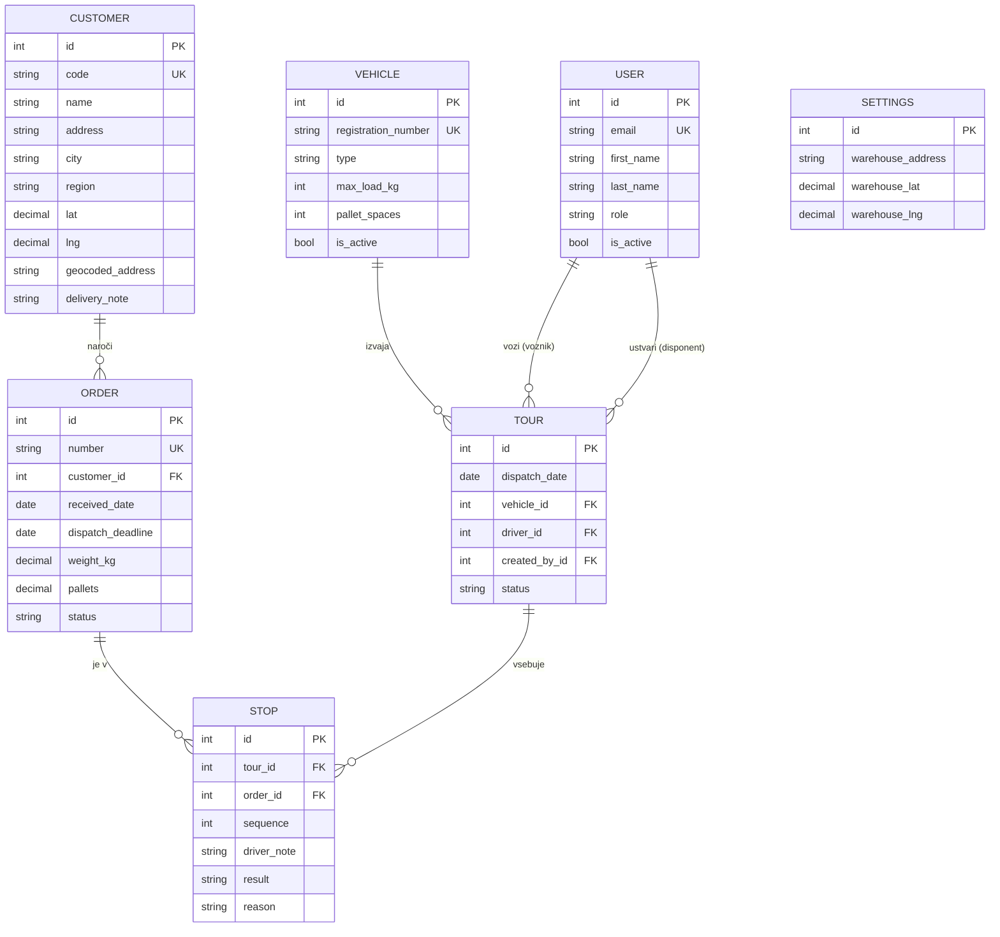
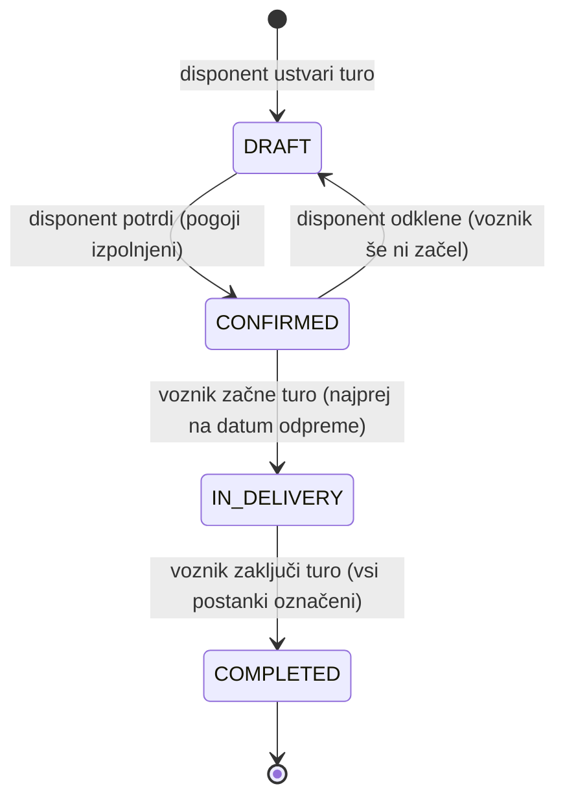
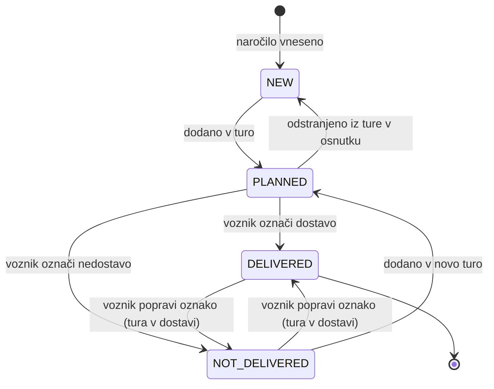

# 03 – Podatkovni model

Rešitev uporablja **relacijsko podatkovno bazo (SQLite)**. Tabele se ustvarijo iz Django modelov z migracijami. Imena tabel, polj in statusov so zapisana v angleščini, ker se uporabljajo neposredno v kodi, opisi pa so v slovenščini. Uporabniku so statusi prikazani s slovenskimi nazivi (npr. `DRAFT` kot »Osnutek«).

Oznake: **PK** – primarni ključ, **FK** – tuji ključ (povezava na drugo tabelo), **UK** – enolična vrednost.

## Entitete

### Uporabnik (`User`)

Razširja vgrajenega Django uporabnika, zato shranjevanje gesel in preverjanje prijave delujeta z vgrajenimi mehanizmi.

| Polje | Tip | Opis |
|---|---|---|
| `id` | celo število, PK | |
| `email` | besedilo, UK | uporablja se za prijavo |
| `password` | besedilo | zgoščeno geslo |
| `first_name`, `last_name` | besedilo | ime in priimek |
| `phone` | besedilo, neobvezno | telefon |
| `role` | izbira | `DISPATCHER` (disponent), `DRIVER` (voznik), `ADMIN` (administrator) |
| `is_active` | logična vrednost | deaktiviran uporabnik se ne more prijaviti |

### Stranka (`Customer`)

| Polje | Tip | Opis |
|---|---|---|
| `id` | celo število, PK | |
| `code` | besedilo, UK | šifra stranke (kot v ERP) |
| `name` | besedilo | naziv, npr. Pekarna Zrno |
| `address`, `postal_code`, `city` | besedilo | naslov dostave (naslov, pošta, kraj) |
| `region` | besedilo | območje dostave, npr. »Podravska«, »Gorenjska« |
| `lat`, `lng` | decimalno število, neobvezno | koordinate za zemljevid in predlog vrstnega reda |
| `geocoded_address` | besedilo, neobvezno | naslov, za katerega veljata `lat` in `lng`; če se naslov stranke spremeni, sistem koordinate ob naslednjem dodajanju naročila v turo poišče znova |
| `contact_name`, `phone` | besedilo, neobvezno | kontaktna oseba za dostavo |
| `delivery_note` | besedilo, neobvezno | stalna opomba, npr. »zadnji vhod, zvoniti 2x« |
| `is_active` | logična vrednost | ali je stranka aktivna |

### Vozilo (`Vehicle`)

| Polje | Tip | Opis |
|---|---|---|
| `id` | celo število, PK | |
| `registration_number` | besedilo, UK | registrska številka, npr. `MB AB-123` |
| `type` | izbira | `VAN` (kombi), `TRUCK` (tovornjak) |
| `max_load_kg` | celo število > 0 | največja dovoljena teža tovora, npr. kombi 1.200, tovornjak 6.000 |
| `pallet_spaces` | celo število > 0 | število EUR palet, kombi 4, tovornjak 16 |
| `is_active` | logična vrednost | neaktivnega vozila ni mogoče izbrati za turo |

### Naročilo (`Order`)

| Polje | Tip | Opis |
|---|---|---|
| `id` | celo število, PK | |
| `number` | besedilo, UK | številka naročila (kot v ERP) |
| `customer_id` | FK → Customer | |
| `received_date` | datum | kdaj je bilo naročilo prejeto |
| `dispatch_deadline` | datum | rok odpreme: najkasnejši dan, ko mora blago oditi iz skladišča |
| `weight_kg` | decimalno število > 0 | teža |
| `pallets` | decimalno število > 0 | število paletnih mest, ki jih zasede naročilo; na 0,25 natančno (npr. 0,25 / 0,5 / 1 / 2,75); poda ga skladišče |
| `description` | besedilo, neobvezno | npr. »moka T-500 40 vreč, sir 12 kg« |
| `status` | izbira | `NEW` (novo), `PLANNED` (planirano), `DELIVERED` (dostavljeno), `NOT_DELIVERED` (nedostavljeno) |

### Tura (`Tour`)

| Polje | Tip | Opis |
|---|---|---|
| `id` | celo število, PK | |
| `dispatch_date` | datum | datum odpreme: dan, ko tura odide iz skladišča (tura lahko traja več dni) |
| `vehicle_id` | FK → Vehicle | |
| `driver_id` | FK → User (vloga `DRIVER`) | |
| `created_by_id` | FK → User (vloga `DISPATCHER`) | |
| `status` | izbira | `DRAFT` (osnutek), `CONFIRMED` (potrjena), `IN_DELIVERY` (v dostavi), `COMPLETED` (zaključena) |
| `note` | besedilo, neobvezno | splošna opomba za celo turo |
| `confirmed_at`, `started_at`, `completed_at` | datum in čas, neobvezno | kdaj je tura prešla v posamezno stanje |

Kombinaciji (`dispatch_date`, `vehicle_id`) in (`dispatch_date`, `driver_id`) sta enolični – vozilo in voznik imata na isti datum odpreme največ eno turo.

### Postanek (`Stop`)

Povezuje turo in naročilo ter hrani vrstni red in rezultat dostave.

| Polje | Tip | Opis |
|---|---|---|
| `id` | celo število, PK | |
| `tour_id` | FK → Tour | |
| `order_id` | FK → Order | |
| `sequence` | celo število ≥ 1 | vrstni red v turi; (`tour_id`, `sequence`) je enolično |
| `driver_note` | besedilo, neobvezno | opomba za voznika, največ 300 znakov |
| `result` | izbira | `PENDING` (čaka), `DELIVERED` (dostavljeno), `NOT_DELIVERED` (ni dostavljeno) |
| `reason` | besedilo, neobvezno | razlog nedostave; obvezno, če je `result = NOT_DELIVERED` |
| `marked_at` | datum in čas, neobvezno | kdaj je voznik označil rezultat |

### Nastavitve (`Settings`)

Tabela z **eno samo vrstico** sistemskih nastavitev, ki jih ureja administrator. Z drugimi tabelami ni povezana; njene vrednosti uporablja poslovna logika (začetna točka za predlog vrstnega reda in zemljevid).

| Polje | Tip | Privzeta vrednost |
|---|---|---|
| `id` | celo število, PK | vedno 1 |
| `warehouse_address` | besedilo | naslov skladišča |
| `warehouse_lat`, `warehouse_lng` | decimalno, neobvezno | koordinate skladišča |

## Povezave med entitetami

| Povezava | Kardinalnost | Pomen |
|---|---|---|
| Customer → Order | 1 : N | stranka ima več naročil |
| Vehicle → Tour | 1 : N | vozilo vozi več tur |
| User (voznik) → Tour | 1 : N | voznik vozi več tur |
| User (disponent) → Tour | 1 : N | disponent ustvari več tur |
| Tour → Stop | 1 : N | tura ima več postankov |
| Order → Stop | 1 : N | naročilo je lahko skozi čas v več postankih (npr. prvič nedostavljeno, drugič dostavljeno), a hkrati v največ eni aktivni turi |

## Osnutek podatkovnega modela (ER diagram)

Branje povezav: `||` = natanko ena, `o{` = nič ali več. Primer: `CUSTOMER ||--o{ ORDER` pomeni, da ima stranka nič ali več naročil, vsako naročilo pa pripada natanko eni stranki.

`SETTINGS` je v diagramu brez povezav, ker gre za samostojno tabelo z eno vrstico.

## Življenjski cikel ture

## Življenjski cikel naročila

## Pravila celovitosti podatkov

- `Order.pallets` je večje od 0 in deljivo z 0,25.
- Kapaciteta ture: vsota `weight_kg` vseh naročil v turi ≤ `max_load_kg` vozila **in** vsota `pallets` ≤ `pallet_spaces` vozila. Tura s preseženo kapaciteto ne more preiti v `CONFIRMED`.
- Naročilo je lahko v turi le, če `Tour.dispatch_date ≥ Order.received_date`. Če je `Tour.dispatch_date > Order.dispatch_deadline`, se prikaže opozorilo.
- Naročilo je lahko hkrati v največ eni turi s statusom `DRAFT`, `CONFIRMED` ali `IN_DELIVERY`.
- Voznik ima lahko hkrati največ eno turo v statusu `IN_DELIVERY`.
- Zaporedja postankov v turi so 1, 2, …, N brez lukenj in podvajanj.
- Postankov ture, ki ni v statusu `DRAFT`, ni mogoče dodajati, odstranjevati ali preurejati.
- Zaključenih tur, postankov in naročil se ne briše; uporabnikov, strank in vozil se ne briše, ampak deaktivira.
