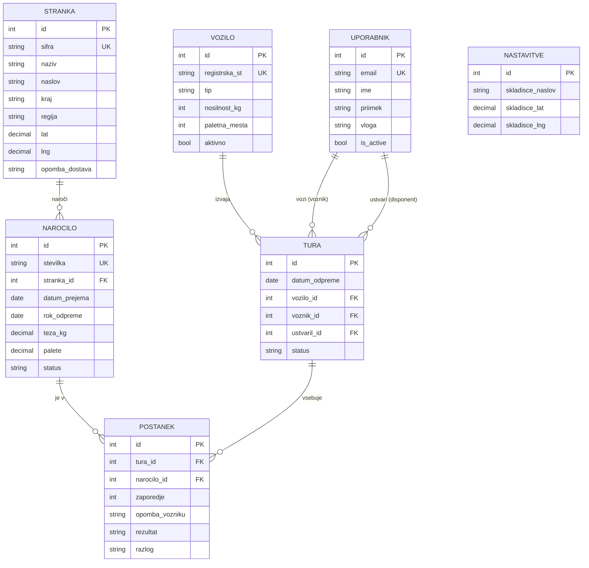
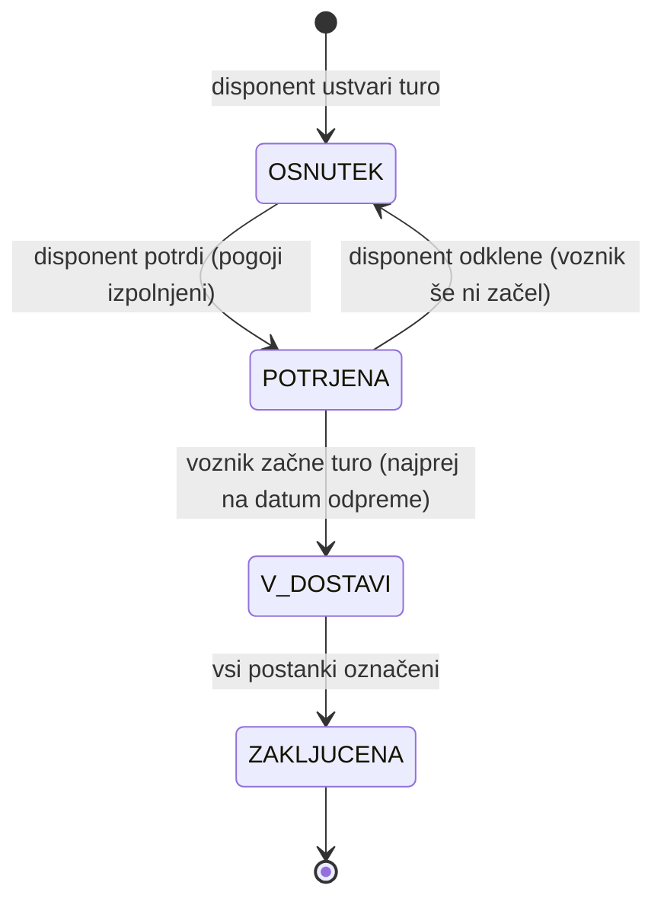
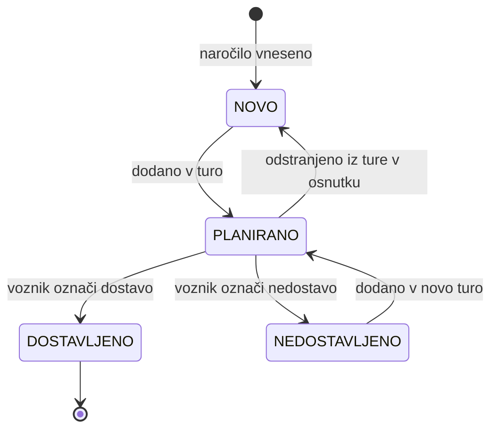

# 03 – Podatkovni model

Rešitev uporablja **relacijsko podatkovno bazo (SQLite)**. Tabele se ustvarijo iz Django modelov z migracijami. Imena polj so zapisana brez šumnikov, ker se uporabljajo neposredno v kodi.

Oznake: **PK** – primarni ključ, **FK** – tuji ključ (povezava na drugo tabelo), **UK** – enolična vrednost.

## Entitete

### Uporabnik (`Uporabnik`)

Razširja vgrajenega Django uporabnika, zato shranjevanje gesel in preverjanje prijave delujeta z vgrajenimi mehanizmi.

| Polje | Tip | Opis |
|---|---|---|
| `id` | celo število, PK | |
| `email` | besedilo, UK | uporablja se za prijavo |
| `password` | besedilo | zgoščeno geslo |
| `ime`, `priimek` | besedilo | |
| `telefon` | besedilo, neobvezno | |
| `vloga` | izbira | `DISPONENT`, `VOZNIK`, `ADMIN` |
| `is_active` | logična vrednost | deaktiviran uporabnik se ne more prijaviti |

### Stranka (`Stranka`)

| Polje | Tip | Opis |
|---|---|---|
| `id` | celo število, PK | |
| `sifra` | besedilo, UK | šifra stranke (kot v ERP) |
| `naziv` | besedilo | npr. Pekarna Zrno |
| `naslov`, `posta`, `kraj` | besedilo | naslov dostave |
| `regija` | besedilo | območje dostave, npr. »Štajerska«, »Nemčija – Bavarska« |
| `lat`, `lng` | decimalno število, neobvezno | koordinate za zemljevid in predlog vrstnega reda |
| `kontakt`, `telefon` | besedilo, neobvezno | kontaktna oseba za dostavo |
| `opomba_dostava` | besedilo, neobvezno | stalna opomba, npr. »zadnji vhod, zvoniti 2x« |
| `aktivna` | logična vrednost | |

### Vozilo (`Vozilo`)

| Polje | Tip | Opis |
|---|---|---|
| `id` | celo število, PK | |
| `registrska_st` | besedilo, UK | npr. `MB AB-123` |
| `tip` | izbira | `KOMBI`, `TOVORNJAK` |
| `nosilnost_kg` | celo število > 0 | največja dovoljena teža tovora, npr. kombi 1.200, tovornjak 6.000 |
| `paletna_mesta` | celo število > 0 | število EUR palet, kombi 4, tovornjak 16 |
| `aktivno` | logična vrednost | neaktivnega vozila ni mogoče izbrati za turo |

### Naročilo (`Narocilo`)

| Polje | Tip | Opis |
|---|---|---|
| `id` | celo število, PK | |
| `stevilka` | besedilo, UK | številka naročila (kot v ERP) |
| `stranka_id` | FK → Stranka | |
| `datum_prejema` | datum | kdaj je bilo naročilo prejeto |
| `rok_odpreme` | datum | najkasnejši dan, ko mora blago oditi iz skladišča |
| `teza_kg` | decimalno število > 0 | |
| `palete` | decimalno število > 0 | število paletnih mest, ki jih zasede naročilo; na 0,25 natančno (npr. 0,25 / 0,5 / 1 / 2,75); poda ga skladišče |
| `opis` | besedilo, neobvezno | npr. »moka T-500 40 vreč, sir 12 kg« |
| `status` | izbira | `NOVO`, `PLANIRANO`, `DOSTAVLJENO`, `NEDOSTAVLJENO` |

### Tura (`Tura`)

| Polje | Tip | Opis |
|---|---|---|
| `id` | celo število, PK | |
| `datum_odpreme` | datum | dan, ko tura odide iz skladišča (tura lahko traja več dni) |
| `vozilo_id` | FK → Vozilo | |
| `voznik_id` | FK → Uporabnik (vloga `VOZNIK`) | |
| `ustvaril_id` | FK → Uporabnik (vloga `DISPONENT`) | |
| `status` | izbira | `OSNUTEK`, `POTRJENA`, `V_DOSTAVI`, `ZAKLJUCENA` |
| `opomba` | besedilo, neobvezno | splošna opomba za celo turo |
| `potrjeno_ob`, `zacetek_ob`, `zakljuceno_ob` | datum in čas, neobvezno | kdaj je tura prešla v posamezno stanje |

Kombinaciji (`datum_odpreme`, `vozilo_id`) in (`datum_odpreme`, `voznik_id`) sta enolični – vozilo in voznik imata na isti datum odpreme največ eno turo.

### Postanek (`Postanek`)

Povezuje turo in naročilo ter hrani vrstni red in rezultat dostave.

| Polje | Tip | Opis |
|---|---|---|
| `id` | celo število, PK | |
| `tura_id` | FK → Tura | |
| `narocilo_id` | FK → Narocilo | |
| `zaporedje` | celo število ≥ 1 | vrstni red v turi; (`tura_id`, `zaporedje`) je enolično |
| `opomba_vozniku` | besedilo, neobvezno | največ 300 znakov |
| `rezultat` | izbira | `CAKA`, `DOSTAVLJENO`, `NI_DOSTAVLJENO` |
| `razlog` | besedilo, neobvezno | obvezno, če je `rezultat = NI_DOSTAVLJENO` |
| `oznaceno_ob` | datum in čas, neobvezno | kdaj je voznik označil rezultat |

### Nastavitve (`Nastavitve`)

Tabela z **eno samo vrstico** sistemskih nastavitev, ki jih ureja administrator. Z drugimi tabelami ni povezana; njene vrednosti uporablja poslovna logika (začetna točka za predlog vrstnega reda in zemljevid).

| Polje | Tip | Privzeta vrednost |
|---|---|---|
| `id` | celo število, PK | vedno 1 |
| `skladisce_naslov` | besedilo | naslov skladišča |
| `skladisce_lat`, `skladisce_lng` | decimalno, neobvezno | koordinate skladišča |

## Povezave med entitetami

| Povezava | Kardinalnost | Pomen |
|---|---|---|
| Stranka → Naročilo | 1 : N | stranka ima več naročil |
| Vozilo → Tura | 1 : N | vozilo vozi več tur |
| Uporabnik (voznik) → Tura | 1 : N | voznik vozi več tur |
| Uporabnik (disponent) → Tura | 1 : N | disponent ustvari več tur |
| Tura → Postanek | 1 : N | tura ima več postankov |
| Naročilo → Postanek | 1 : N | naročilo je lahko skozi čas v več postankih (npr. prvič nedostavljeno, drugič dostavljeno), a hkrati v največ eni aktivni turi |

## Osnutek podatkovnega modela (ER diagram)

Branje povezav: `||` = natanko ena, `o{` = nič ali več. Primer: `STRANKA ||--o{ NAROCILO` pomeni, da ima stranka nič ali več naročil, vsako naročilo pa pripada natanko eni stranki.

`NASTAVITVE` je v diagramu brez povezav, ker gre za samostojno tabelo z eno vrstico.

## Življenjski cikel ture

## Življenjski cikel naročila

## Pravila celovitosti podatkov

- `Narocilo.palete` je večje od 0 in deljivo z 0,25.
- Kapaciteta ture: vsota `teza_kg` vseh naročil v turi ≤ `nosilnost_kg` vozila **in** vsota `palete` ≤ `paletna_mesta` vozila. Tura s preseženo kapaciteto ne more preiti v `POTRJENA`.
- Naročilo je lahko v turi le, če `Tura.datum_odpreme ≥ Narocilo.datum_prejema`. Če je `Tura.datum_odpreme > Narocilo.rok_odpreme`, se prikaže opozorilo.
- Naročilo je lahko hkrati v največ eni turi s statusom `OSNUTEK`, `POTRJENA` ali `V_DOSTAVI`.
- Voznik ima lahko hkrati največ eno turo v statusu `V_DOSTAVI`.
- Zaporedja postankov v turi so 1, 2, …, N brez lukenj in podvajanj.
- Postankov ture, ki ni v statusu `OSNUTEK`, ni mogoče dodajati, odstranjevati ali preurejati.
- Zaključenih tur, postankov in naročil se ne briše; uporabnikov, strank in vozil se ne briše, ampak deaktivira.
