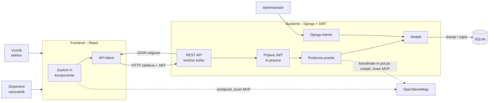

# 04 – Arhitektura in tehnološki sklad

## Arhitektura

TuraPlan je spletna aplikacija, sestavljena iz dveh ločenih aplikacij in podatkovne baze:

- **frontend** – aplikacija v **Reactu**, ki teče v brskalniku in prikazuje uporabniški vmesnik,
- **backend** – aplikacija v **Djangu** z **REST API-jem**, ki vsebuje poslovna pravila in dostop do podatkov,
- **podatkovna baza** – **SQLite**.

Frontend in backend sta ločena projekta, ki se zaganjata posebej in komunicirata **izključno prek REST API-ja** v obliki JSON.

### Glavni deli sistema

| Del | Kaj dela |
|---|---|
| **Frontend (React)** | Zasloni za disponenta (računalnik) in voznika (telefon): seznam tur, sestavljanje ture, tura za voznika … Prikazuje podatke, ki jih dobi iz API-ja, in pošilja uporabnikova dejanja (npr. »potrdi turo«) na API. Vmesnik je odziven, zato deluje tudi na telefonu. |
| – strani in usmerjanje | posamezni zasloni in prehodi med njimi (React Router) |
| – komponente | ponovno uporabni deli vmesnika: tabela tur, kartica postanka, prikaz zasedenosti vozila … |
| – API klient | funkcije, ki pošiljajo zahteve na backend in prilagajo prijavni žeton |
| **Backend (Django + Django REST Framework)** | Sprejema zahteve frontenda, preveri prijavo in pravice, izvede poslovna pravila, bere in zapisuje podatke ter vrne odgovor v JSON. |
| – API končne točke (`views`) | naslovi, na katere frontend pošilja zahteve (npr. `/api/tours/`) |
| – serializerji (`serializers`) | pretvorba podatkov iz baze v JSON in nazaj ter preverjanje vnosov (obvezna polja, formati) |
| – poslovna pravila (`services`) | preverjanje kapacitete, pravila sestavljanja ture, prehodi statusov; zbrana v enem modulu, da jih je enostavno testirati |
| – pravice (`permissions`) | kdo sme dostopati do česa (vloge, voznik samo do svojih tur) |
| – modeli (`models`) | opis tabel kot Python razredi (`Customer`, `Order`, `Vehicle`, `Tour`, `Stop`, `Settings`, `User`) |
| – Django Admin | vgrajen administracijski vmesnik za vnos osnovnih podatkov (uporabniki, vozila, stranke, naročila) v MVP |
| **Podatkovna baza (SQLite)** | trajno shranjevanje vseh podatkov |
| **OpenStreetMap** (zunanja storitev, izven MVP) | podlaga za zemljevid (F-10), pretvorba naslova v koordinate (F-11) in pot po cestah (F-15) |

### Komunikacija med deli sistema

1. Uporabnik odpre aplikacijo – brskalnik naloži React aplikacijo.
2. Ko uporabnik nekaj naredi (npr. klikne »Potrdi turo«), React pošlje HTTP zahtevo na backend, npr. `POST /api/tours/15/confirm/`. V glavi zahteve pošlje prijavni žeton (JWT).
3. Backend preveri žeton (kdo je uporabnik) in vlogo (ali sme to narediti), izvede poslovna pravila in podatke zapiše v bazo.
4. Backend vrne odgovor v JSON s statusno kodo:
   - `200` / `201` – uspeh (vrne posodobljeno turo),
   - `400` – kršeno poslovno pravilo (vrne razloge, npr. »kapaciteta presežena za 1,5 palete«),
   - `401` – uporabnik ni prijavljen,
   - `403` – uporabnik nima pravic.
5. React prikaže rezultat brez ponovnega nalaganja strani.

Primer odgovora backenda na `GET /api/tours/15/`:

```json
{
  "id": 15,
  "dispatch_date": "2026-11-03",
  "status": "DRAFT",
  "vehicle": { "registration_number": "MB AB-123", "max_load_kg": 1200, "pallet_spaces": 4 },
  "driver": { "id": 7, "first_name": "Janez", "last_name": "Novak" },
  "total_weight_kg": 980,
  "total_pallets": 4.5,
  "is_over_capacity": true,
  "stops": [ { "sequence": 1, "customer": "Pekarna Zrno", "pallets": 1.5, "weight_kg": 320 } ]
}
```

Pri zemljevidu (izven MVP) frontend podlago zemljevida naloži neposredno z OpenStreetMap, backend pa ob dodajanju naročila v turo poizve koordinate naslova stranke pri storitvi Nominatim (če jih stranka še nima ali se je njen naslov spremenil) in jih shrani pri stranki. Če zunanja storitev ni dosegljiva, se naročilo vseeno doda, postanek pa ostane brez oznake na zemljevidu. Pot ture po cestah (črto, razdaljo in čas vožnje) backend poizve pri storitvi OSRM; če ta ni dosegljiva, frontend nariše ravne črte in pokaže zračno razdaljo.

### Diagram



### Glavne končne točke REST API

| Metoda in naslov | Namen | Vloga |
|---|---|---|
| `POST /api/auth/login/` | prijava, vrne žetona JWT | vse |
| `GET /api/auth/me/` | podatki o prijavljenem uporabniku in njegovi vlogi | vse |
| `GET /api/tours/` | seznam tur s filtri (obdobje datumov odpreme, status) | Disponent |
| `POST /api/tours/` | nova tura | Disponent |
| `GET /api/tours/options/?date=…` | prosta vozila in vozniki za izbrani datum | Disponent |
| `GET /api/tours/{id}/` | podrobnosti ture s postanki (s koordinatami strank), zasedenostjo, skladiščem in zračno razdaljo | Disponent, Voznik (samo svoje) |
| `PATCH /api/tours/{id}/` | menjava vozila ture v osnutku | Disponent |
| `POST /api/tours/{id}/stops/` | dodaj naročilo v turo; stranki brez koordinat ali s spremenjenim naslovom poišče lokacijo | Disponent |
| `DELETE /api/stops/{id}/` | odstrani postanek iz ture | Disponent |
| `POST /api/stops/{id}/move/` | premik postanka gor, dol ali na poljubno mesto | Disponent |
| `PATCH /api/stops/{id}/` | opomba za voznika | Disponent |
| `POST /api/stops/{id}/delivery-note/` | shrani ali odstrani stalno opombo stranke | Disponent |
| `GET /api/tours/{id}/suggested-order/` | predlog vrstnega reda postankov s predlagano in trenutno zračno razdaljo ter potjo predloga po cestah (nič se ne shrani) | Disponent |
| `POST /api/tours/{id}/suggested-order/` | shrani vrstni red iz prikazanega predloga (`stop_ids`) | Disponent |
| `GET /api/tours/{id}/route/` | pot ture po cestah: razdalja, čas vožnje in črta za zemljevid; `road` je `null`, če OSRM ni dosegljiv | Disponent |
| `POST /api/tours/{id}/confirm/` | potrditev ture | Disponent |
| `POST /api/tours/{id}/unconfirm/` | vrnitev ture v osnutek | Disponent |
| `GET /api/orders/?date=…&region=…` | nerazporejena naročila | Disponent |
| `GET /api/orders/search/?q=…` | iskanje naročil po številki (točno ujemanje) ali nazivu stranke (delno, od 3 znakov); zadetek ima status, turo in razlog zadnje nedostave | Disponent |
| `GET /api/my-tours/` | potrjene, začete in zaključene ture prijavljenega voznika | Voznik |
| `POST /api/tours/{id}/start/` | začetek ture | Voznik |
| `POST /api/stops/{id}/result/` | označitev ali popravek dostave oziroma nedostave z razlogom | Voznik |
| `POST /api/tours/{id}/complete/` | zaključek ture, ko so označeni vsi postanki | Voznik |

### Podatkovna baza

**SQLite** – relacijska baza, shranjena v eni datoteki v backend projektu. Tabele se ustvarijo samodejno iz Django modelov z migracijami (`migrate`). Do baze dostopa samo backend, frontend nikoli neposredno. Podroben model je v `03-podatkovni-model.md`.

### Avtentikacija in upravljanje uporabnikov

- Ker sta frontend in backend ločeni aplikaciji, se uporablja prijava z **žetoni JWT** (JSON Web Token):
  1. uporabnik v Reactu vpiše e-pošto in geslo, frontend ju pošlje na `POST /api/auth/login/`,
  2. backend preveri geslo (shranjeno zgoščeno) in vrne dva žetona: kratkotrajni dostopni žeton in dolgotrajnejši žeton za osvežitev,
  3. frontend dostopni žeton pošilja v glavi vsake zahteve; ko poteče, z žetonom za osvežitev pridobi novega,
  4. ob odjavi frontend žetona izbriše.
- **Registracije ni** – račune ustvari administrator, ker gre za interno aplikacijo.
- Vsak uporabnik ima vlogo (`DISPATCHER`, `DRIVER`, `ADMIN`). Frontend glede na vlogo prikaže ustrezne zaslone, **pravice pa vedno preveri backend** – voznik lahko npr. odpre samo ture, kjer je on voznik. Zahteva uporabnika napačne vloge vrne `403`, tuja tura ali osnutek pa za voznika vrne `404`, kot da ne obstaja.
- Administrator za Django Admin uporablja vgrajeno prijavo Djanga.

### Lokalni zagon

Najpreprostejši je zagon z Dockerjem: `docker compose up --build` zažene backend in frontend, koraki so v [README](../README.md). Brez Dockerja so potrebni Python 3.12, Node.js (LTS) in Git. Repozitorij ima ločeni mapi za backend in frontend:

```text
turaplan/
  backend/     ← Django projekt
  frontend/    ← React projekt
  docs/        ← dokumentacija
```

Backend (prvi terminal):

```bash
cd backend
python -m venv .venv
source .venv/bin/activate            # Windows: .venv\Scripts\activate
pip install -r requirements.txt
python manage.py migrate             # ustvari tabele v bazi
python manage.py createsuperuser     # prvi administrator
python manage.py seed_data          # testni uporabniki, stranke, vozila, naročila in ture
python manage.py runserver           # API na http://localhost:8000
```

Frontend (drugi terminal):

```bash
cd frontend
npm install                          # namesti knjižnice
npm run dev                          # aplikacija na http://localhost:5173
```

Ker frontend in backend tečeta na različnih naslovih, backend z nastavitvijo CORS izrecno dovoli zahteve s frontenda.

## Tehnološki sklad

| Področje | Tehnologija |
|---|---|
| Frontend | **React** (JavaScript), **Vite** (zagon in gradnja projekta), **React Router** (zasloni), **Bootstrap 5** (izgled in prilagoditev telefonu) |
| Backend | **Python 3.12**, **Django 5**, **Django REST Framework** (REST API) |
| Podatkovna baza | **SQLite** (prek Django ORM) |
| Avtentikacija | **JWT** (knjižnica `djangorestframework-simplejwt`), vloge v polju `User.role` |
| Povezava frontend–backend | REST API v JSON, `django-cors-headers` za dovoljenje zahtev s frontenda |
| Lokalni razvoj | **Docker Compose** (zagon z enim ukazom) ali Python `venv` in `npm`; **VS Code**, **Git** in GitHub |
| Testiranje | **pytest-django** (poslovna pravila in API), **oxlint** (preverjanje kode frontenda) |
| Zemljevid (izven MVP) | **Leaflet** (`react-leaflet`) + **OpenStreetMap** – brezplačno, brez API ključa |
| Geokodiranje (izven MVP) | **Nominatim** (OpenStreetMap) |
| Pot po cestah (izven MVP) | **OSRM** (javni strežnik nad podatki OpenStreetMap) – brezplačno, brez API ključa |

## Arhitekturne odločitve

Podrobna utemeljitev vsake odločitve (kontekst, obravnavane alternative, posledice) je v arhitekturnih odločitvah (ADR) v mapi [`adr/`](adr/).

| Odločitev | Utemeljitev |
|---|---|
| **React za frontend** ([ADR-01](adr/01-react-za-frontend.md)) | Vmesnik ima dva zelo različna pogleda (disponent na računalniku, voznik na telefonu), ki se sproti posodabljata. React ju gradi iz ponovno uporabnih komponent in ima pripravljene knjižnice za prehode med zasloni in zemljevid. |
| **Django + Django REST Framework za backend** ([ADR-02](adr/02-django-in-drf-za-backend.md)) | Backend potrebuje uporabnike z vlogami, relacijsko bazo in REST API. Django ima uporabnike, delo z bazo in admin vmesnik že vgrajene, DRF pa doda REST API, zato se lahko posvetimo poslovni logiki. |
| **REST API v JSON** ([ADR-03](adr/03-rest-api-v-json.md)) | Frontend in backend sta ločeni aplikaciji, zato komunicirata prek API-ja. REST je standarden in preprost: vsak vir ima svoj naslov, vsako končno točko je mogoče neposredno preizkusiti, na enak način se lahko kasneje poveže tudi ERP sistem. |
| **Prijava z JWT** ([ADR-04](adr/04-prijava-z-jwt.md)) | Frontend žeton pošlje z vsako zahtevo, backend pa iz njega prepozna uporabnika in njegovo vlogo. Enak način prijave lahko kasneje uporabi mobilna aplikacija, frontend in backend pa ni treba imeti na istem naslovu. |
| **SQLite** ([ADR-05](adr/05-sqlite-kot-podatkovna-baza.md)) | Podatki so relacijski, uporabnikov je malo. SQLite ne potrebuje namestitve in je privzeta v Djangu; prek Django ORM jo lahko kasneje zamenjamo s PostgreSQL brez spreminjanja kode. |
| **OpenStreetMap za zemljevid** ([ADR-06](adr/06-openstreetmap-za-zemljevid.md)) | Jedro rešitve je postopek planiranja in kontrola kapacitete, ne algoritem poti. OpenStreetMap je brezplačen in ne potrebuje API ključa; Google Maps je predviden kot nadgradnja. |
| **OSRM za pot po cestah** ([ADR-07](adr/07-osrm-za-pot-po-cestah.md)) | Disponent potrebuje realno razdaljo in čas vožnje. OSRM uporablja iste podatke OpenStreetMap, je brezplačen in ne potrebuje API ključa; če ni dosegljiv, aplikacija uporabi zračno razdaljo. |
| **Docker Compose za lokalni zagon** ([ADR-08](adr/08-docker-compose-za-lokalni-zagon.md)) | Projekt ima ločen backend in frontend. Z Docker Compose se oba zaženeta z enim ukazom v enakem okolju, ročni zagon pa ostane mogoč. |

## Možnost nadaljnjega razvoja

- **PostgreSQL** – ob večjem številu uporabnikov zamenjamo SQLite (sprememba nastavitev, koda ostane enaka).
- **Integracija z ERP sistemom** – ERP lahko naročila pošilja neposredno na obstoječi REST API.
- **Mobilna aplikacija** za voznike lahko uporablja isti REST API.
- **Google Maps Routes API** – optimizacija vrstnega reda po dejanskih cestah z upoštevanjem prometa.
