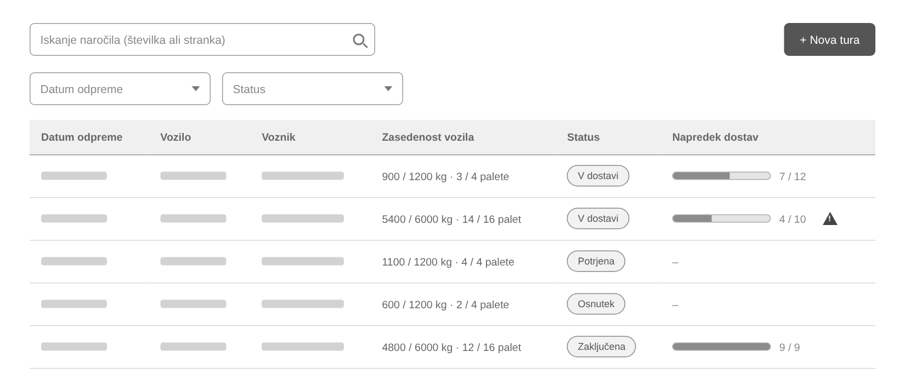
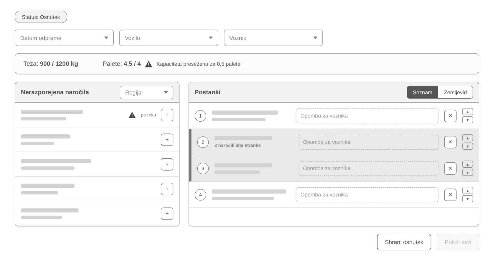
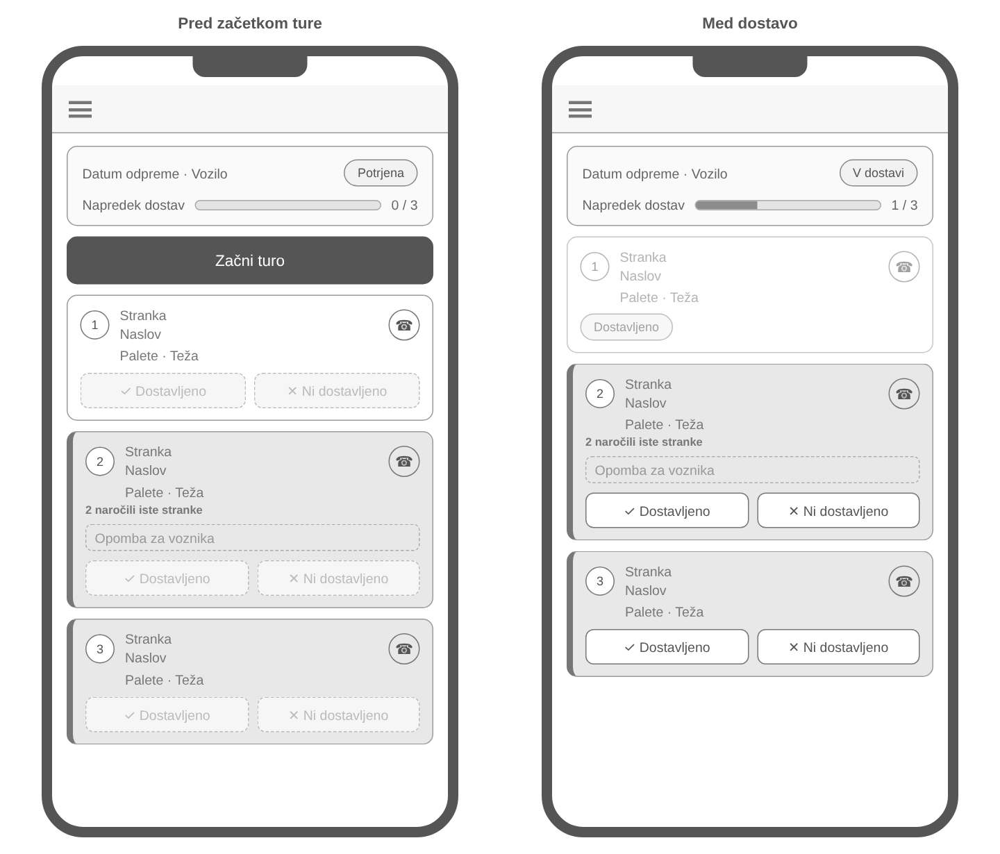

# 06 – Wireframes

Wireframe-i prikazujejo osnovno postavitev treh ključnih zaslonov aplikacije TuraPlan. Napisi označujejo polja, gumbe in stolpce, podatki (npr. imena strank in voznikov) pa so nadomeščeni s sivimi črtami.

## 1. Seznam tur (disponent)

Začetni zaslon disponenta s pregledom vseh tur. Ture lahko filtrira po datumu odpreme in statusu, z iskalnim poljem pa hitro najde posamezno naročilo. Pri vsaki turi vidi zasedenost vozila (teža in palete glede na zmogljivost), status in napredek dostav. Opozorilni znak označuje turo z nedostavljenim postankom.

## 2. Sestavljanje ture (disponent)

Zaslon za sestavljanje ture: disponent izbere datum odpreme, vozilo in voznika ter iz seznama nerazporejenih naročil (s filtrom po regiji) doda naročila v turo. Zgoraj sproti vidi zasedenost vozila; ko je kapaciteta presežena, se prikaže opozorilo in potrditev ture ni mogoča. Pri vsakem postanku lahko vpiše opombo za voznika, ga premakne gor ali dol po vrstnem redu ali odstrani iz ture; postanki iste stranke so vizualno združeni. S preklopom »Seznam | Zemljevid« lahko disponent postanke prikaže tudi na zemljevidu.

## 3. Tura na telefonu (voznik)

Pogled voznika na telefonu: levo tura pred začetkom, ko voznik turo začne z gumbom »Začni turo«, desno med dostavo. Na vrhu sta povzetek ture in napredek dostav, spodaj postanki po vrstnem redu s stranko, naslovom, paletami, težo, opombo in gumbom za klic stranke. Pri vsakem postanku voznik označi »Dostavljeno« ali »Ni dostavljeno« (z obveznim razlogom).
